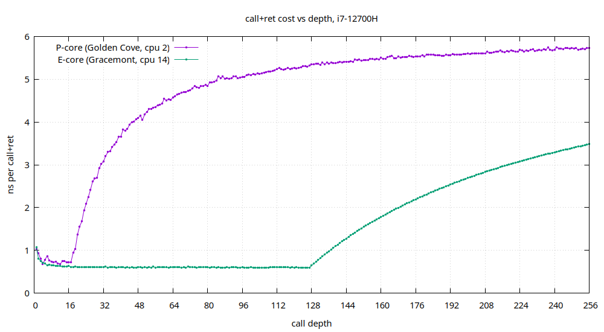

I wanted to know how big the return address stack (RAS, Intel calls it the RSB) is on my laptop.
It's an i7-12700H, so it has two kinds of cores: Golden Cove P-cores (cpus 0-11) and Gracemont E-cores (cpus 12-19).
Intel doesn't really publish these numbers anymore for newer cores, so the only way is to measure it.

The RAS is a small stack inside the branch predictor. Every `call` pushes the return address onto it and every `ret` pops it to guess where it is going back to.
If you go deeper than the stack is, the oldest entries get overwritten, and on the way back up those returns get mispredicted.
So the idea is simple: nest calls deeper and deeper and look for where `ret` suddenly gets slow.

## The benchmark

I didn't want the compiler doing anything clever, so the call chain is just raw asm.
256 functions, each one aligned to 16 bytes, each one just calls the next block and returns:

```c
__asm__(
    ".text\n"
    ".balign 16\n"
    "chain_base:\n"
    ".rept 256\n"
    "  call .+16\n"      // call the next 16-byte block
    "  ret\n"
    "  .balign 16\n"
    ".endr\n"
    "  ret\n"
);
extern char chain_base[];
```

Since every block is the same size, jumping into the chain at `chain_base + 16 * (256 - d)` gives you a depth of exactly `d`.
Then I just time it a lot of times and divide:

```c
void (*fn)(void) = (void (*)(void))(chain_base + 16 * (MAXD - d));
double t0 = now();
for (int i = 0; i < iters; i++) fn();
double t = (now() - t0) / iters / (d + 1); // +1 for the outer call
```

Take the best of 7 runs for each depth and pin it to a core with `taskset`:

```sh
gcc -O2 -o ras ras.c
taskset -c 2  ./ras > pcore.csv
taskset -c 14 ./ras > ecore.csv
```

The full source is [here](ras.c).

## Results



- **P-core**: flat at ~0.7ns till depth 18, then it goes up at 19-20. Counting the outer call, that's a RAS of about **20 entries**.
  After that every extra level costs ~5.5ns, which is ~25 cycles at 4.6GHz, so basically a full mispredict per return.
- **E-core**: flat at ~0.6ns all the way till 127, and then a very clean knee at 128. So Gracemont has a **128 entry** RAS.

This honestly surprised me. The small core has a return stack around 6x the size of the big core.
My first run only went up to depth 128 and the E-core line was completely flat, so I assumed it was falling back to the BTB once the RAS ran out
(every `ret` in this chain always goes back to the same place, so the BTB would predict it perfectly).
That was wrong. Going to 256 showed the knee was just sitting right at the edge of my range.

## Does this match what others found?

Kind of. Intel's optimization manual only says that Alder Lake gives each hardware thread its own copy of the return stack. No sizes.
Agner Fog's [microarchitecture guide](https://www.agner.org/optimize/microarchitecture.pdf) has 16 for Haswell through Skylake,
and [this post](https://parallelprogrammer.substack.com/p/covert-caches-return-stack-buffer) quotes 22 for Ice Lake and 128 for Gracemont, also measured.
So 128 on the E-core lines up exactly, and ~20 on the P-core is in the same range as the older big cores.
I couldn't find anyone with a number for Golden Cove specifically.

Some caveats:
- I'm timing with `clock_gettime`, not cycle counters, so the absolute ns depend on what clock the core is running at. The knee is the part I trust, the absolute ns not so much.
- This is the best case for a RAS test. Every return has a fixed target. A test where the return targets are random would rule out any other predictor helping, which I might try next.
